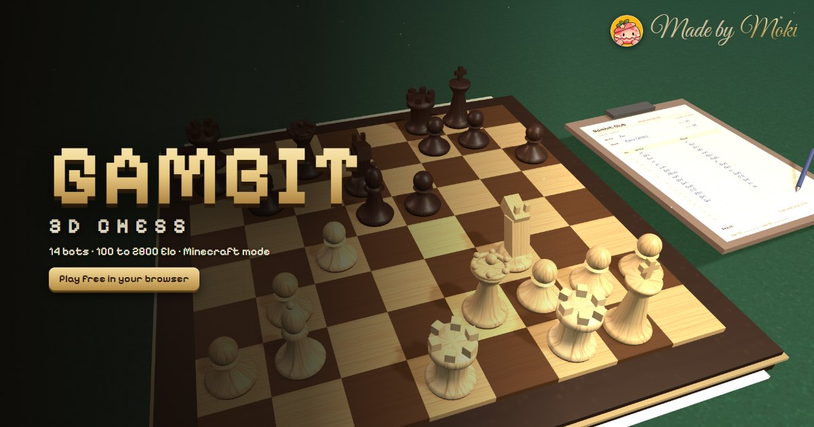
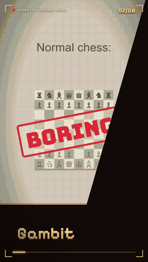
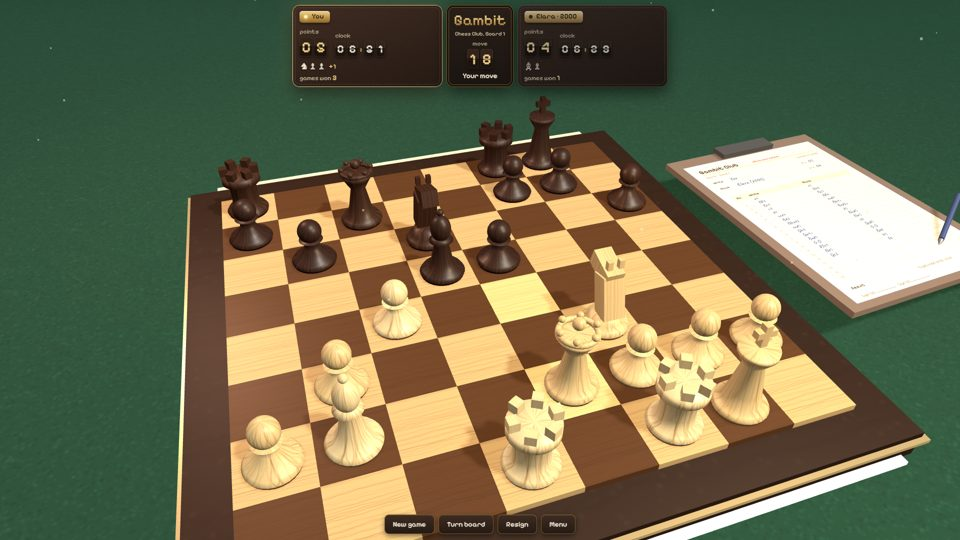
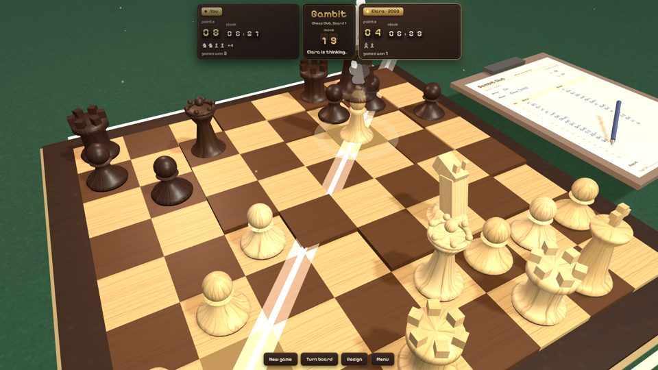
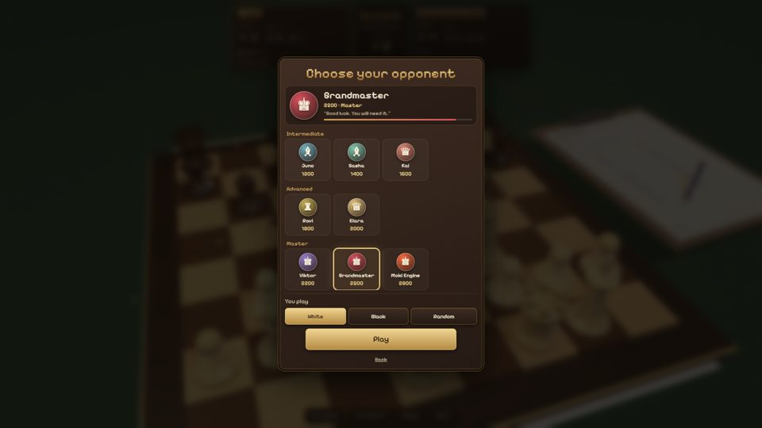
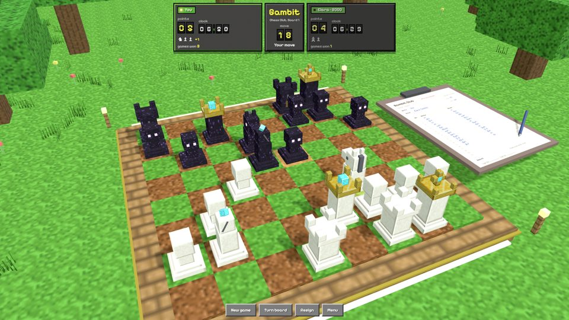

<p align="center"></p>

<h1 align="center">Gambit — 3D Chess</h1>

<p align="center"><b>Chess, but every capture is a little action movie.</b><br>
Free 3D chess in your browser: 14 bots from 100 to 2800 Elo, a unique kill animation for every piece, and a checkmate that blows up the board.</p>

<p align="center">
  <a href="https://chess3d-kappa.vercel.app"><b>▶ Play now</b></a> ·
  <a href="#features">Features</a> ·
  <a href="#run-it-locally">Run locally</a> ·
  <a href="#the-engine">The engine</a>
</p>

<p align="center"></p>

No sign-up, no download, no ads. Works on desktop and phones, and can be installed as an offline app.

## Features

| | |
|---|---|
| ♜ **Every piece kills differently** | Pawns jab, rooks ram, knights stomp, bishops fire a holy beam, queens explode in a royal nova, and kings turn their victim into gold coins. |
| 🤖 **14 bots, 100 → 2800 Elo** | From Pip (*"Is this the pointy horse?"*) to Moki Engine (*"No mercy. No mistakes."*). The top bots run a real search engine in a Web Worker. |
| ♟ **Real chess rules** | Castling, en passant, promotion with a piece picker, draws by threefold repetition, the 50-move rule and insufficient material. |
| ⏱ **Chess clocks** | 3, 5, 10 or 15 minutes per side, or off. Resign with a double tap. |
| 🧱 **Two themes** | A wooden club board, or a Minecraft-style blocky world with glowing-eyed obsidian pieces, trees, torches and a pond. |
| 💥 **Checkmate blast** | Mate the king and every piece and tile goes flying while the board burns. |
| 📝 **Live scoresheet** | Every move is written in proper notation (`Nbd2`, `exd6`, `cxb8=N`) on a clipboard next to the board. |
| 👥 **Play a friend** | Pass-and-play on one screen, with an optional auto-flip board. |

<p align="center">
  
  
  
  
</p>

## The bots

| Tier | Bots |
|---|---|
| Beginner | Pip 100 · Nora 250 · Biscuit 400 |
| Novice | Otto 600 · Mira 800 · Dev 1000 |
| Intermediate | Juno 1200 · Sasha 1400 · Kai 1600 |
| Advanced | Ravi 1800 · Elara 2000 |
| Master | Viktor 2200 · Grandmaster 2500 · Moki Engine 2800 |

The Elo numbers are labels for the ladder, not measured ratings. Lower bots search less deeply, add noise to their move scores and sometimes play a random move; the Master tier plays the engine's best move with a few seconds to think.

## Controls

- **Tap or click** a piece, then a glowing square.
- **Drag** to turn the board, **pinch or scroll** to zoom.
- **Menu → Settings** for theme, clock, graphics quality, sound, hints and effects.

## Run it locally

It's plain HTML, CSS and JavaScript with no build step. Serve the folder with any static server:

```bash
python -m http.server 8000
```

Then open http://localhost:8000. Opening `index.html` straight from disk also works; the engine then runs on the main thread instead of a Web Worker.

Libraries load from CDNs: [three.js r128](https://threejs.org), [anime.js](https://animejs.com) and [Motion](https://motion.dev), plus Google Fonts.

## The engine

`js/engine.js` is a from-scratch chess engine:

- 0x88 board with make/unmake and Zobrist hashing
- Principal variation search with a transposition table, null-move pruning, late move reductions, futility and reverse futility pruning, check extensions
- Move ordering with MVV-LVA, killer moves and a history table
- Quiescence search with delta pruning
- PeSTO tapered piece-square evaluation, plus bishop pair, pawn structure, rook files, king shelter and a mop-up term for winning endgames
- Repetition and 50-move draw detection inside the search

It passes the standard perft suites and searches around a million positions per second on a desktop.

## Project structure

```
index.html        page shell and menus
css/style.css     UI, both themes
js/01-config.js   settings and helpers
js/02-rules.js    move generation and game rules
js/03-scene.js    three.js scene, boards, pieces, blocky world
js/04-state.js    game state, bot ladder, scoresheet
js/05-fx.js       highlights and small effects
js/06-moves.js    moves, kill animations, checkmate blast
js/07-ai.js       talks to the engine worker
js/08-ui.js       HUD, clock, camera and input
js/09-boot.js     render loop, settings and bot picker
js/10-pwa.js      offline install
js/engine.js      chess engine (Web Worker)
sw.js             service worker for offline play
```

## Credits

Made by **Rishav Ranjan** and **M Gyaani** at **Moki Studio**.

## License

The code is released under the [MIT License](LICENSE).

The Gambit name, the Moki name and the Moki mascot artwork (`moki.png`) are Moki Studio's branding. Please don't use them to present a fork as the official game.

*Minecraft is a trademark of Mojang Synergies AB. Gambit is not affiliated with or endorsed by Mojang or Microsoft.*
